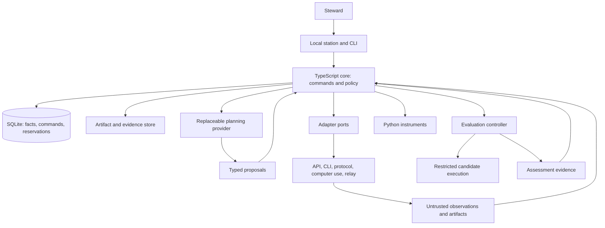

# OpenCorral architecture: the owner of the outcome

Authored by Codex at Scott E. Frias's direction, sourced from a highly detailed prompt and a user directed rigorous review of the existing, deeply researched corpus of documents on 2026-10-21. Logic carried over from the prior spine restored by Claude on 2026-10-22. The steward adopted this document, with [IMPLEMENTATION_PLAN.md](IMPLEMENTATION_PLAN.md) and [CORE_CONTRACT.md](CORE_CONTRACT.md), as the spine the code is built to on 2026-10-22. It is a coding blueprint, not a claim that the runtime exists. The product scope is an open, provider-independent corral for harnessed models across media. The language is a TypeScript core and station with Python instruments behind JSON contracts. [ROADMAP.md](ROADMAP.md) alone records delivery status.

## 1. The architectural decision

**Build a local, evidence-bearing results orchestrator. Its durable asset is the relationship between an intention, the exact results that satisfy it, what those results cost, and the evidence about the services that produced them.**

The corral holds what must survive the departure of a model, a session, a vendor, or a tool. A user may employ one service for research, another for images, another for narration, and another for assembly. OpenCorral keeps the purpose, carries the right materials between them, evaluates the resulting whole, accounts for the expenditure, and learns which pairings to use next.

The central loop is:

```text
Intention → outcome contract → assignment → attempt → artifact revisions
    ↑                                                    ↓
    └── replan ← measured experience ← acceptance ← assessment
```

Task decomposition is one possible planning act inside this loop. The product remains useful when the user supplies the entire plan, existing harnesses do the decomposition, or all outputs arrive through a manual relay. Achievement belongs to the objective, not to the employee's session.

Three spaces must remain distinct:

| Space | Question | Authority |
|---|---|---|
| Access surface | What can this connection observe or do? | Adapter conformance and current connection state |
| Sapescape | What has this harness/model/configuration demonstrated under these conditions? | Outcome evidence, with uncertainty and attribution limits |
| Authority | What may the corral do here, for this user and this objective? | User grants, corral policy, current service conditions |

A service can have exceptional creative ability and poor telemetry. An API can expose powers that this user has not granted. Neither fact should corrupt the other two spaces.

### The waterline

OpenCorral owns outcome contracts, cross-service plans and handoffs, artifact lineage, independent assessment, resource accounting, and recommendations. It calls existing harnesses for execution loops, context management, tools, media production, and internal agent coordination. It may ask a harness to use supported isolation; it does not build another general harness to obtain it.

Computer use is an adapter path through an existing computer-use harness. Manual relay is another path. Neither establishes permission by itself. A future embedded open harness or local model stack is one more service binding behind the same interface, with no privileged path to acceptance.

## 2. Keep the implementation small

**Recommendation: a TypeScript modular monolith on a pinned supported Node runtime; a TypeScript station; SQLite; files for large artifacts; Python workers where instruments justify them. Do not add Rust to the initial domain implementation.**

The important complexity is semantic and operational: truthful evidence, safe execution, and correct acceptance. Most core work is I/O, state transitions, schema validation, and UI. A third implementation language would multiply packaging and contract work before solving a demonstrated problem.

| Choice | Why it fits | What would cause reconsideration |
|---|---|---|
| TypeScript core and station | One language for adapters, typed command handlers, and interface; preserves decision 0003 | A measured bottleneck or platform constraint |
| Python instruments behind JSON | Reuse statistical, media, and evaluation libraries without a second state owner | A specific worker's startup or serialization cost prevents its required workload |
| SQLite with one core writer | Local transactions for evidence and reservations without an external service | Measured contention or a real need for several authoritative hosts |
| Browser station first; Windows installer for outside users | Tests the product before committing to a shell | Actual accessibility, installation, update, and native-integration needs |
| Rust deferred | Useful for a selected native boundary or measured processing need | A bounded component with a benchmark and maintenance owner |

React with a small build toolchain is a reasonable station default, not an architectural dependency. Pin dependencies in the first implementation slice. Keep the SQLite driver behind a narrow storage module and test it in the Windows package. A single installation is the requirement; a single executable is an experiment. Node's [single-executable](https://nodejs.org/api/single-executable-applications.html) and [SQLite](https://nodejs.org/api/sqlite.html) facilities have their own support and packaging constraints; product correctness must not depend on a packaging shortcut.

Start with packages inside one repository and one release. No microservices, broker, distributed consensus, graph database, vector database, or generic workflow language is needed for the first useful corral.

### Why this split, rather than another plausible one

The decisive axis is where the changing product logic lives. A Python core is a credible alternative if instruments dominate the product or the maintainer team is substantially stronger in Python; here the central work is contracts, adapter coordination, state and the station. Keeping that logic in TypeScript reduces the number of places a contributor must change to add one complete user capability. Python remains valuable precisely where its instrument ecosystem pays for the boundary. A Rust core would make sense if native containment, sustained data processing or strict resource footprint were the dominant constraint; none has yet been demonstrated. Rust would not by itself solve mistaken acceptance, stale evidence, or duplicate remote effects.

TypeScript's types also do not authenticate a caller or validate a runtime message. The JSON/semantic/authority checks below remain mandatory. This recommendation favors a small maintainable product over a theoretical language winner. Reconsider a bounded component when measurements change the tradeoff; do not migrate the domain because one adapter needs native code.

In every language, bounded queues and recovery semantics matter more here than raw execution speed. Keep CPU-heavy parsing, media processing and large hashing work off the control plane's latency-sensitive path. Measure responsiveness, footprint and maintenance effort during the real slices before selecting another runtime.

## 3. Processes and authority



The core is the only writer of authoritative corral state. The station, adapters, planner, evaluator, and Python instruments submit commands or observations. They do not write core tables. This keeps policy at one boundary even when workers are separate processes.

The planner consumes a deliberately scoped context bundle. It does not hold database credentials, acceptance keys, or ambient actuator authority. Core command handlers enforce the same rules for model proposals, CLI commands, and station actions.

Adapters and instruments become separate processes when dependency isolation, failure containment, or permissions require it. A subprocess alone is not a security sandbox. Strong evaluation separation needs a distinct operating-system or remote execution boundary, described in section 8.

One machine is the initial authority. Later remote workers submit authenticated observations to that machine; they do not open its database over a share. Multi-device synchronization and teams are later designs, not implied by adding a corral ID.

### Boundary contracts

| Boundary | Request | Result and failure behavior |
|---|---|---|
| Station/CLI to core | Command kind/version, command ID, expected revisions, scoped arguments | Committed IDs and new revisions, or typed validation/authority/conflict result; retry of the same command ID cannot duplicate a local transition |
| Core to adapter | Operation ID, supported operation/version, work-order snapshot, scoped input references | External handle and observations, explicit unsupported/error, or ambiguous outcome requiring reconciliation |
| Core to planner | Provider capabilities, context-manifest digest, state preconditions, proposal schema, episode budget | Attributed proposal and usage; never a direct domain mutation |
| Core to evaluator | Exact subject manifest, contract/policy/evaluator versions, evidence requirements | Assessments with evidence references and assurance; the core derives acceptance when an authorized command requests it |
| Core to Python instrument | Protocol version, request ID, operation, input references, calculation version | Typed derived result naming its inputs, or typed failure; never an authoritative acceptance |

For the first local Python workers use one bounded JSON request on stdin and one JSON response on stdout, with diagnostics on stderr. The supervisor supplies timeout, cancellation and output-size limits; a nonzero exit, malformed response, mismatched request/version or absent response is failure, never reuse of an earlier result. Media/log bytes stay in scoped files referenced by digest rather than embedded as base64 in messages. Long-lived framed workers are an optimization to justify later. Domain schemas and transport protocol versions are independent.

## 4. Domain records, not a class hierarchy

Use plain immutable records, opaque IDs, tagged unions, and explicit transition functions. Classes can own resources such as clients; avoid an inheritance tree of agents and vendor subclasses. A new modality should normally add an artifact profile and evaluation pack, not change the identity of an objective.

These are conceptual boundaries, not one SQL table or package per row:

| Record | Owns | Does not own |
|---|---|---|
| Corral | Explicit membership, versioned policy, resource scope, lifecycle | Implicit inheritance of another corral's permissions |
| GoalRevision | Desired outcome, scope, required dependencies, selected alternatives, contract reference | A provider session or editable completion checkbox |
| OutcomeContract | Versioned criteria, result slots, acceptable evidence methods, release conditions | Hidden probes or prescribed internal reasoning |
| ServiceBinding | User connection, adapter version, supported operations, account references | A universal capability score |
| ExecutionProfile | Observed harness/model/configuration/environment snapshot and identity gaps | Secrets or invented precise model identity |
| WorkOrder | Immutable assignment: contract, exact inputs, allowed effects, resource envelope | The canonical goal or whole firm's policy |
| Attempt | One execution; external handles, transitions, resource events | Proof of acceptance |
| ArtifactRevision | Exact content identity, type, locations, availability, input lineage, producing attempt | A mutable path treated as immutable content |
| Assessment | Criterion result over an exact subject, method, evaluator, evidence, assurance | Routing preference or mutable blame |
| Decision | Typed proposal, authorization, human judgment, acceptance, or revision decision | An untyped blob allowed to grant itself authority |
| ResourceAccount and observations | Installation-wide shared quota/cost buckets, readings, reservations and settlements, with explicit corral allocations | A per-model or per-corral fiction for one provider allowance |

Small values such as subject reference, money, quantity, criterion reference, and evidence reference belong inside these records. Do not make every noun an aggregate. Proposals, human judgments, and authorizations are separate decision variants with different validators and permitted callers. Goal state, current acceptance, cost totals, and sapescape cells are projections, not independently editable records.

### Identity and versioning

A service binding names the connection; an execution profile records what was known during an attempt. Store harness and adapter versions, observed and requested model identifiers, configuration fingerprint, tool availability, environment, and observation sources. A provider alias that hides the actual model stays an alias. Unknown version has a reason, not a fabricated value.

Fingerprints cover a versioned, allowlisted configuration schema and canonical serialization. Exclude credentials and unrelated machine data. Record the fingerprint recipe; otherwise two hashes cannot establish comparability. A harness using several internal models is measured as that system unless component usage is exposed. Configuration changes start distinguishable evidence cohorts; deliberate pooling is a versioned analysis choice.

Goals, assignments, evidence access and decisions are corral-scoped. The shared resource ledger is owned by the local authority because one provider account can support bindings in several corrals. Corrals receive explicit allocations/grants against that same account identity; creating a second corral must not create another allowance. Cross-corral artifact reuse needs an explicit grant; membership alone grants neither data access nor spending authority. Independent installations cannot promise atomic reservations against one account without a later shared authority; show that limitation rather than implying distributed quota control.

## 5. Goals, results, and handoffs

The goal graph has required-dependency edges and informational relations. Required dependencies form a DAG and are checked for cycles. Start with conjunctions of required children. Represent alternatives by selecting a branch in a goal revision before it can supply acceptance; defer a general Boolean language. Optional work stays visible but cannot block a required result. Failed historical attempts cannot block an accepted replacement simply because they appear beneath the same goal.

A goal has a stable identity and immutable revisions. The current revision explicitly selects the required child revisions/results; an acceptance pins the child acceptance IDs that satisfied them. Execution inputs are always pinned. Changing a selected dependency creates a new goal revision and makes affected current applicability stale transitively until reassessed or explicitly found equivalent. Historical dependency references never retarget to the newest result.

Every goal has its own criteria, including integration criteria. Images, script, and narration may each pass while the assembled video mispronounces a name, uses the wrong image, or contradicts its captions. **Composition creates a new result subject and requires its own assessment.** Child acceptance is necessary only where the contract says so; it is never sufficient by itself.

An artifact set is a canonical manifest of named output slots and exact revision IDs/digests. Its digest identifies the assessed whole. A handoff supplies allowed input revisions, relevant contract text, decisions, and evidence summaries. It does not dump another service's transcript into the next service. Context preparation is a budgeted operation with recorded inputs and provenance.

Handoff compatibility includes format, dimensions or duration where relevant, permitted use, disclosure scope, exportability and continued availability. Required conversion is an explicit budgeted transformation producing a new revision, with its own possible information loss. A superb output that the next service cannot consume is not yet a usable plan. Record context supplied and assistance given so downstream results are attributed to the actual chain rather than the final service alone.

Some outcomes change the external world rather than produce a file. Reserve an effect-receipt subject profile for operation ID, target identity, acknowledged effect, verification observation/time, and unresolved uncertainty. A successful exit or screenshot is evidence, not automatic proof that the intended external state exists. This profile is deferred until an actual release/publication integration needs it; it uses the same assessment and authority rules.

Choose an explicit artifact retention mode:

- **Managed snapshot:** immutable local bytes addressed by content hash. Preferred for accepted deliverables and inspection evidence, where copying is permitted.
- **External reference:** provider identifier, version if exposed, locator, observed digest if available, and last availability check. Never invent a digest for inaccessible bytes.
- **Both:** local snapshot plus original service location.

Large media streams directly to the artifact store. A locator is not identity. Expiring URLs belong in private location metadata; they are not durable receipts or exportable credentials. External-only material can be accepted only under a contract permitting that evidence level. Later unavailability is distinct from the historical decision.

Editing an input creates a new revision. Existing results remain historically accepted for their exact inputs; applicability to the current goal becomes stale when its dependency rules require the new input. Explicit equivalence assessment can validate unchanged applicability. Never copy an old PASS onto new bytes silently.

Execution and acceptance are separate projections. Attempt states include prepared, queued, dispatching, running, waiting, produced, failed, cancelled, and outcome unknown. Goal states include open, in progress, needs attention, awaiting assessment, accepted, and stale. Cancellation is a request before it is a confirmed state.

Pause is a durable dispatch hold on a goal or corral. It survives restart, blocks new dispatch and automatic retries, and continues to receive observations. Requesting cancellation of active attempts is a separate action; a paused objective may still have externally running work. Resumption revalidates queued work before dispatch.

### Enduring concerns and bounded episodes

The user's sphere of concerns outlives individual projects. Reserve a goal-purpose distinction between **attain** (produce a defined result) and **maintain** (keep a condition true, or keep its assurance current). A maintained concern does not become permanently DONE. Keep its lifecycle separate from current assurance: supported within a stated evidence scope and validity interval, violated by a supported finding, or unknown because evidence is absent or stale.

An intention can also exist before it has acceptance criteria. Represent that as a lightweight concern/context variant of the goal record: purpose, scope, lifecycle and links to the bounded goals that serve it. Those links do not AND every historical project into a completion test. Capturing a concern requires no invented contract; dispatch still requires a concrete bounded assignment and applicable contract. This is a tagged semantic distinction, not another hierarchy of agent classes.

An enduring concern carries context, boundaries, a review obligation and a resource ceiling. Actual work occurs in bounded review or repair episodes using the same goals, contracts and attempts. Each episode can finish while the concern remains active. Time validity and scope come from its evidence method; elapsed time without an observed problem does not establish success, and a point observation cannot imply continuous coverage.

The first release implements attained outcomes and manual review obligations. Recurring execution is a later service using the same command authority, holds, budget and reconciliation rules. This preserves the concept without building a scheduler or another task engine into the initial kernel.

Time-sensitive projections take an explicit as-of time as well as an event watermark. A clock can make a review due, not grant permission or spend. On restart, recompute overdue attention without dispatching from replay; a missed interval must not produce an unbounded backlog of duplicate review episodes. Maintained goals need a budget period or lifetime ceiling, not an infinite grant implied by an infinite purpose.

## 6. Persistence and schema discipline

### Transactional facts with replayable views

Use an append-only domain journal plus operational tables for commands, outbox delivery, reservations, and leases. Not every token is a domain event. An event log is not permission to repeat external actions.

The journal is authoritative for domain transitions and immutable metadata; content-addressed files hold retained bytes. Current-state indexes and display views are rebuildable, not competing authoritative CRUD records. Event payloads contain reconstructible facts or immutable references. Command-critical indexes update in the same transaction and are never replaced by stale UI projections. Command/effect receipts and operational delivery state survive projection rebuild; replay cannot regenerate dispatchable work. [CORE_CONTRACT.md](CORE_CONTRACT.md) specifies the deliberately small S1 kernel.

Commands that change mutable choices or state, including station and CLI edits, supply expected head versions. Check those versions, dependency cycles, reference integrity, and acceptance preconditions in the same transaction that records the transition and any outbox work. Conflicts require reconciliation. Append-only observations instead name immutable attempt/subject references and source/deduplication identity; they pass current authority checks but do not conflict merely because another observation arrived.

Keep three identifiers separate: semantic goal/contract revision, optimistic-concurrency head version, and journal sequence. New telemetry advances the journal; it does not revise an outcome contract. Local command IDs are scoped to caller and corral and bound to the request digest. Retrying the identical command returns its recorded result; reusing its ID with different arguments is a conflict.

A domain envelope carries core-minted identity, corral, event type and schema version, local sequence, recorded time, source, and provenance kind. Optional fields include source time, source event ID, attempt, causation, and evidence references. An adapter must not invent timestamps, roles, tool results, or costs to fill a universal envelope.

Provenance distinguishes observed, reported, derived, and declared information. A model's completion message is a reported claim even when its bytes were faithfully observed. A derived indicator names algorithm version and input references. Corrections append a supersession link without altering source evidence.

Local sequence orders ingestion, not external reality. Deduplicate by source identity and stable event ID or cursor where available. A content hash alone must not collapse two legitimate identical events. Preserve late arrivals and ordering uncertainty. Parse errors and telemetry gaps describe the sensor, not zero activity.

Projections record calculation version and input watermark. Rebuild into a shadow projection and switch atomically; failed rebuilds leave the live view intact. Replay never invokes an actuator.

Use short SQLite transactions and a bounded writer queue. WAL supports local readers while the writer runs, but still has a single writer and companion files. Use a local filesystem; [SQLite's WAL documentation](https://sqlite.org/wal.html) defines those constraints. Handle checkpointing, disk-full errors, ingestion backpressure, and worker timeouts explicitly.

Write blobs to temporary files, finish hashing and durability handling, then atomically install them before committing references. A crash may leave an unreferenced blob for reconciliation; it must not create accepted references to incomplete content. Back up the database consistently together with an artifact manifest and test restore. [SQLite's backup API](https://sqlite.org/backup.html) is suitable; copying only a live database file is not the backup design.

### Four different kinds of validity

| Layer | Checks | Example |
|---|---|---|
| Structural | Shapes, discriminators, required fields, closed objects | Machine assessment cannot use a human-judgment payload |
| Semantic | Cross-field and state invariants | Required failed checks cannot yield acceptance; units match |
| Referential/evidentiary | Referenced identities, bytes, revisions, sources | Evaluated digest equals the selected artifact digest |
| Authority | Caller, role separation, scope, signature trust where used | Builder cannot submit authoritative acceptance |

JSON Schema is necessary and cannot do all four jobs. A true independence flag and a string called signature establish neither independence nor authenticity. Closed shapes cannot prevent sensitive content appearing in an allowed string.

Keep JSON Schema 2020-12 for persisted/interchange records, generated TypeScript types, and pinned validators. Prefer discriminated payloads to giant optional-field events. Test composed-object closure; the [JSON Schema object reference](https://json-schema.org/understanding-json-schema/reference/object) explains the distinction between additionalProperties and unevaluatedProperties. Resolve references only from the packaged registry; imported records cannot trigger arbitrary schema downloads.

Every field has one of three origins:

1. **Corral-authored structure:** IDs, revisions, transitions, policy declarations. Justified by architectural invariants, never passed off as vendor telemetry.
2. **Harvested observation:** present in a source, with source hash/cursor and extraction recipe. Missing values remain absent with a documented gap.
3. **Derived analysis:** calculated from cited inputs by a versioned method. Never relabeled observation.

Synthetic cases can test protocols and failures when labeled synthetic. They cannot count as empirical harvests or evidence of ability. A new corral-generated ID need not pretend to exist in an old vendor log.

### Evolution and the current suite

An earlier schema suite was graded FAIL by an independent review and is not published here. Its fixtures and schemas are historical design material, not certified v1 contracts. Do not repair their provenance by invention or promote validation success into a measured fact. The working contracts are the shared types in [packages/contracts](../packages/contracts/index.ts) and the payload bench described in [IMPLEMENTATION-NOTES.md](IMPLEMENTATION-NOTES.md).

Build new contracts under a versioned namespace after the first end-to-end harvest. Preserve raw records and decoder versions. Pure explicit transformations produce new interpretations linked to their inputs. Retain unknown versions, quarantined from authority until a decoder exists. Breaking field, event, or policy meaning requires a new version; additive fields still need a reader compatibility policy.

SQLite layout, record schemas, extraction recipes, and projections have separate migration versions. The journal reduces destructive migrations; it does not remove them. Backup and restore must survive interrupted migration before release.

An export is a versioned manifest plus selected records, schema/interpretation identifiers and permitted retained artifacts, with integrity digests and explicit unavailable references. It includes the contract, exact result and evidence needed to understand a receipt without the original provider session. It excludes secrets and hidden evaluator payloads; a public receipt can identify a sealed pack without disclosing it. Exported evidence states any inspection limits rather than implying complete reproducibility. Re-import preserves original identities/provenance and records the import itself; it does not create new successful attempts or give a foreign receipt local trust automatically.

OpenTelemetry is an import/export mapping, not the domain language. Pin conventions at the adapter boundary. The official [conventions index](https://opentelemetry.io/docs/specs/semconv/) and [GenAI registry](https://opentelemetry.io/docs/specs/semconv/registry/attributes/gen-ai/) document an evolving surface. A telemetry rename must not rewrite contracts or force invented data.

## 7. The interchangeable reasoning layer

OpenCorral normally has an LLM behind it. Interchangeability means replacing that provider changes neither the goal store nor who can authorize an action.

A PlanningProvider port offers capability discovery, proposal generation, supported cancellation, and usage reporting. Normalize the minimum useful exchange: a scoped context bundle in, a versioned proposal out. Negotiate text, media inputs, structured output, context limits, and tool proposals. Native providers and local models use the same port. An OpenAI-compatible endpoint may be one adapter; it is not the definition of independence.

A permitted harness can also supply the planning model through a provider implementation that obtains a bounded proposal. Its subscription authentication remains with that harness. Provider interchangeability is about the contract and authority, not an obligation to purchase a separate API plan or extract a service's private credentials.

A proposal references a state revision and known goal, contract, artifact, and service IDs. It contains proposed commands, rationale, missing information, and estimated resources. The core validates all four layers above. Stale preconditions require a revised proposal, not applying an old plan to a changed world.

The model may propose criteria, task descriptors, routing alternatives, handoff summaries, diagnoses, creative reviews, and replans. These stay attributed proposals until an authorized transition adopts them. The model cannot grant permissions, issue its own budget, write verdicts, or turn unknown into PASS.

Imported transcripts and artifacts are untrusted evidence. They cannot change policy by containing instructions. Label sources, select excerpts, and record redaction when preparing context. Apply egress policy before sending it to any provider, including a reviewer. A fallback cannot disclose private materials to a different provider without an applicable grant.

Planner usage, failed calls, and review calls enter the same resource ledger. Set finite call/iteration and spend limits for each planning episode. Failure produces a visible incomplete proposal; fallback is a new recorded attempt with its own provider and cost. Import, inspection, manual planning, evaluation, and acceptance remain available when the LLM is unavailable.

## 8. Assessment, acceptance, and independent authority

**Assessment says what a method found. Acceptance says whether a particular result satisfies a particular contract under a particular policy.** This lets one kernel handle code and art without pretending art has a unit-test oracle.

Before dispatch, freeze the outcome criteria, acceptance policy and evidence methods for that attempt. A post-result change creates a new contract revision and a labeled reassessment; it cannot count as first-pass success under the original contract. Imports of work produced before any registered contract are labeled retrospective and excluded from prospective comparison unless explicitly analyzed as a separate cohort.

Each criterion declares its method:

| Method | Evidence | Authority |
|---|---|---|
| Deterministic verifier | Test logs, dimensions, codecs, schema checks, exact requirements | Versioned evaluator and acceptance policy |
| Steward judgment | Decision about the exact artifact and rubric, with rationale | Steward |
| Model review | Critique, factual leads, proposed findings | Advisory; cannot clear a required gate or replace required human judgment |

Machine results include pass, fail, unknown, and error. Optional/not-applicable criteria must be declared or validly resolved under the contract. Acceptance requires all required evidence, passing required checks, required human judgments, sufficient assurance, and current subject identity. A tool crash or probe without a verdict blocks that requirement. No model decides the gate.

The policy also specifies which assessments apply and how conflicts are resolved. S1 uses explicit supersession and authoritative selection: contradictory applicable findings on the same criterion/subject block acceptance until a versioned correction, rerun or adjudication resolves them. A caller cannot select the convenient PASS while ignoring an unresolved applicable FAIL. Retracted or superseded findings stay inspectable, with their resolution reason.

Taste is honestly recorded as judgment, not an objective quality score. A steward can revise a contract or grant a separate release exception with a reason, but cannot rewrite a failed assessment as historical PASS. A revised contract creates a new measurement context. Role separation is checked against actual principals and operations, not just names such as builder and grader.

### Evaluate the evaluator

Passing a reproducible check establishes that check's result, not that the contract fully captured the user's intention. Record evaluator coverage, known blind spots and applicability. A planner may help draft criteria; adopting an underspecified contract does not make a vacuous result useful. Review contract completeness against the intended outcome before dispatch, and treat doubts as questions about the contract rather than failures of the producing service.

Later discoveries enter as findings with evidence and affected subjects. An authorized reassessment can withdraw current applicability or require repair while preserving the original acceptance and its then-known basis. Capability projections show first-pass acceptance, later-discovered defects, observation duration and any censored follow-up separately. A newer evaluation pack does not silently regrade history; explicit re-evaluation creates new assessments, and some unavailable artifacts may remain unresolvable.

A reported allegation is not a confirmed failure. It can create review-needed state under policy; an authorized assessment confirms, dismisses or leaves it unresolved. If an evaluator version is found defective, enumerate its affected assessment IDs and mark reliability unresolved pending a bounded reassessment decision. Do not automatically fail every product or launch an expensive re-evaluation campaign. Withdrawn prerequisite acceptance also changes the current applicability of dependents without rewriting historical receipts.

Measure an evaluator's defects and disagreements without treating model consensus as ground truth. Validated defects in the product, a changed user preference, and a changed rubric are distinct reasons for reassessment. Keep their denominators separate so a service is not penalized for a later change in what was wanted.

An evaluation pack declares each supported claim, scope, known blind spots, version, validation evidence and exposure/reuse conditions. Provenance, independence, execution protection and measurement validity stay separate dimensions rather than one assurance score. Acceptance is an accountable, fallible decision supported by specified evidence; determinism makes the rule reproducible, not omniscient.

The code pack pins base, candidate, test classification, evaluator version, and environment. New-behavior tests fail on the base and pass on the candidate. Regression guards pass on both. Hidden checks and mutation testing have stated applicability. The first paired run already established the guard-test distinction. Its historical grading rule remains intact; future required checks without verdicts do not yield acceptance.

Receipts bind goal and contract revisions, result-manifest digest, selected dependency acceptance IDs, assessment IDs, evaluator/policy versions, environment, evidence digests, and assurance. Acceptance checks these preconditions atomically against current state. Code also binds repository and exact base/candidate identities. Rebase, squash, or merge requires fresh checking or documented equivalence. Signatures bind a signer to bytes; trust in the signer and execution environment is a separate condition.

### Probe and key protection

Independent authorship/review and probe confidentiality are separate properties. Record both. A same-user process or folder outside the worktree provides neither enforceable secrecy nor proof of non-access. Label it procedural withholding with incomplete observability. Failure output returned to a builder names a failing check by an opaque identifier and never carries probe text or logs, because check output handed to the next agent becomes a target. The trace watch flags any tool call that touches the probe store as a conduct event: a read is detectable even where it is not preventable.

For protected independent machine evaluation, keep the evaluator controller, hidden material, and signing authority outside candidate permissions. Execute candidate code as hostile code in a restricted worker with required inputs only, bounded resources, controlled egress, and limited feedback. The controller can supply selected inputs and observe outputs; candidate code must not inherit controller files, keys, environment, or database access. Generated probes and encryption at rest do not remove this requirement. Packs must document what test execution necessarily reveals.

A procedural development setup can exercise the workflow but cannot claim protected certification. Isolation proceeds in stages. The first build uses procedural withholding: probes live outside every repository and every folder a work order names, and the order carries only their hash. Before any outside user relies on a private-probe claim, the evaluator gains a protected boundary: a separate Windows account whose probe folder the steward's account cannot read, or an encrypted store whose key never reaches an agent's process. Where a pack supports it, probes are generated at grade time from the changed code and a sealed seed, so none exists on disk before the grade (section 16). A public release either demonstrates the isolation its claims require or limits those claims and uses explicit steward assessment. Private probes are not required to prove the manual-relay product loop.

Git hooks provide local feedback and are bypassable: [Git documents no-verify](https://git-scm.com/docs/githooks). Enforcement belongs at the authoritative merge/release or acceptance boundary, refusing missing, stale, or insufficient receipts even when the daemon is absent. [Git notes](https://git-scm.com/docs/git-notes) are receipt exports, not the only store or proof that rewritten commits were graded.

## 9. Adapter ports and durable execution

An adapter implements any subset of **observe**, **act**, and **exchange artifacts**. A log reader need not pretend to launch an agent. A relay need not pretend to see tool calls. A protocol driver does not dictate the goal schema.

Each operation declares protocol/version, credential mode, parameters, effect class, cancellation behavior, reconciliation method, evidence coverage, and conformance record. Availability is the intersection of support, connection state, policy, and authorization. Unsupported operations return explicit results.

ACP, direct API/SDK calls, and headless processes are candidate transports. Negotiate ACP capabilities; [session setup](https://agentclientprotocol.com/protocol/v1/session-setup) and [cancellation](https://agentclientprotocol.com/protocol/v1/cancellation) illustrate why support cannot be assumed. Polling, streaming, and manual import are legitimate sensors when limitations are visible.

Trace readers are versioned extraction adapters over user-authorized records. They are a compatibility burden, not a privileged dependency on internal prompts or authentication stores. Preserve sources and parser versions, report gaps, and disable a broken parser without disabling manual intake.

Computer-use attempts record the participating harness, target service, visible checkpoints where available, and telemetry gaps. Reuse the harness's controls. Relay exports a work order and imports artifacts and a report. Report text is a claim; artifact bytes are inspectable evidence. Unknown identity, quota, or action history remains unknown.

### First adapters and their terms postures

Each adapter declares its terms posture for the credential in use, and the core refuses any act beyond that posture. Each capacity reading carries its source and whether it was observed or entered, and each adapter passes a conformance bench of recorded fixtures before it ships.

Decision 0001's lean places the seams: the gate binds through git (C5) and can ship as a plugin behind other orchestrators (C6); the Agent Client Protocol is the driver seam (C4), headless processes are the interim driver (C2), and the steward relay serves GUI-only harnesses (C9). Trace readers start from each harness's local stores, and they run in the corral's process.

Steering that changes the assigned criteria, allowed effects or input set creates a new immutable assignment revision and attempt segment, linked to its predecessor. A transport may continue the same external session, but attribution and cost record where the assignment changed. Late outputs after cancellation or revision remain evidence of the original scope; adoption into a new scope needs an explicit artifact selection and current assessment.

### Every external effect has a recovery story

1. Validate against current revisions, policy, and grants. Assign a stable operation ID; reserve against both the objective-wide budget and every applicable shared account window.
2. In one transaction, store authorized command, authorization snapshot, reservation, domain event, and outbox item.
3. A leased worker claims the item. Recheck revocations, holds, limits, goal/contract/input revisions, prerequisite acceptance and deadline before dispatch; atomically mark dispatch intent and retain the operation ID. A mismatch suspends the command for reconciliation rather than rewriting it silently.
4. Dispatch with a provider idempotency key where semantics are documented. Record external run ID and acknowledgement.
5. Reconcile observations, register artifacts, settle observed usage, and release unused reservations only when justified.

There is no general exactly-once guarantee across services. A crash after sending but before recording acknowledgement creates **outcome unknown**. Reconcile by lookup/idempotency using the original operation ID where supported. Otherwise show the ambiguity and require a deliberate retry decision. Lease expiry does not prove a paid generation or publication never happened. Fence stale workers locally without pretending the remote service honors that fence.

Reads can retry with bounded backoff. New generation, purchase, message, or publication needs effect-aware rules. Cancellation may incur spend and never implies rollback. Stop automatic work at budget exhaustion or grant revocation and record what may still be running.

An adapter's successful exit moves an attempt toward produced, never directly to accepted.

Late observations are still admitted after cancellation: artifact availability, observed execution outcome, cancellation acknowledgement and permission to continue are different facts. Record late results and charges against the original attempt without resurrecting dispatch or downstream handoffs. Reuse requires deliberate adoption under current prerequisites.

Persist the adapter/decoder version, endpoint/account identity, request digest, and documented idempotency scope/retention with an operation. Updates must retain compatible reconciliation for unresolved operations or leave them explicitly unresolved. A credential rotation, new adapter or expired idempotency window is not permission to redispatch an old command into a new account or interpretation.

## 10. Sapescape: evidence of an operating range

The sapescape is conditional experience, not one intelligence number. It asks: **for work like this, with these inputs, constraints and tools, what has this pairing accomplished, how reliably, at what cost, with what assistance?**

Task descriptors start coarse and versioned: modality, transformation, dependency breadth, constraint burden, tool needs, and context/horizon demands. Add axes when they distinguish useful real cases. A speculative high-dimensional cross product manufactures empty cells faster than knowledge.

Goal-handling ability is measured through behavior: retaining constraints, maintaining dependencies, integrating outputs, recovering after change. These are operational proxies for the cognitive-light-cone idea. The product does not claim direct access to cognition or treat geometry as proof of it.

| Dimension | Evidence shown |
|---|---|
| Outcome reliability | Attempted, assessed, accepted, failed, unassessed, abandoned counts |
| First-pass performance | First-attempt acceptance versus eventual acceptance after repair |
| Quality | Criterion/rubric results and human judgments with method labels |
| Goal continuity | Integration/constraint/recovery outcomes on a versioned task family |
| Efficiency | End-to-end cash/usage, attempt elapsed time, rework and integration expense |
| Conduct | Supported incidents and unresolved attribution, separate from ability |
| Evidence strength | Independent task count, period, identity certainty, exposure, assistance, assurance, drift |

Begin with counts, denominators, comparable cohorts, and visible unknowns. Add intervals or predictions through versioned Python instruments with assumptions stated. Missing measurements are not zeros. No applicable assessments means unknown. With zero accepted units there is no finite measured cost-per-accepted-unit estimate.

Repeated attempts on one task are correlated; show task count separately from attempt count. Report both operational delivery rate and any attribution-filtered estimate, with excluded counts/reasons. Attribution revisions never erase failure or spend. Leave attribution unresolved when evidence cannot distinguish the brief, environment, harness, model, integration, or evaluator.

Repeated maintenance episodes are grouped by concern and condition; repeated repair against one hidden suite is not fresh held-out evidence. Feedback exposure grows across retries. Follow-up duration and actual observation coverage distinguish a recent unchallenged acceptance from a well-observed result; absence of a reported defect is not proof that none exists.

Another employee's success shows feasibility under its conditions, not automatic blame for a different employee. Log candidate sets, chosen service, routing policy, context, resource envelope, and exploratory intent. Selection biases production data; observed rate differences do not prove causal superiority. Paired runs and held-out tasks support stronger comparisons when contamination and assistance are disclosed.

Line survival, time to rewrite, and token counts are diagnostics, not definitions of success. U1 is one task with several builds; its record explicitly does not establish a harness ranking.

Recompute the capability view from evidence under a named analysis version. Self-described ability can help discovery, but cannot populate measured cells. Imported benchmark claims stay separately labeled external evidence until applicability is established.

## 11. Frugality and routing

Money, subscription headroom, credits, compute time, and waiting time are distinct quantities. Store explicit units; money uses currency and exact decimal/minor-unit representation, not floating-point accumulation. Estimates identify price schedule, time, and assumptions. Later settlement can correct reported cost without double counting cumulative totals and per-call deltas.

An account can have overlapping windows shared by multiple bindings. Readings name bucket, units, used/remaining semantics, observation time, reset information, source, and freshness. Reserve atomically against the shared bucket, accounting for existing reservations. External activity and opaque quotas make some availability uncertain; unknown is neither free nor unlimited.

The objective's total budget also covers descendant attempts, replanning, reviewers, transforms and retries. Per-work-order envelopes cannot replenish it. Overlapping short/long windows are simultaneous constraints, not interchangeable allowances. An observation records a coverage cursor or covered operations when available, so usage already reflected in a new cumulative reading is not deducted a second time as a reservation. Retire only the covered portion. If coverage is unknowable, retain a conservative uncertainty bound and show it rather than silently freeing capacity or claiming an exact remaining amount.

Identify fixed-window instances separately from rolling windows. Source ordering and coverage prevent a late old-window reading from overwriting the current one. A reset is not negative spend and does not prove that an unresolved job consumes no future allowance. Preserve uncertainty for reset-spanning jobs until the service's accounting makes their usage attributable.

Distinguish an enforceable remote spend ceiling from a local dispatch budget. Record enforcement coverage and maximum authorized exposure where a service supports them. Unknown final charges or ineffective cancellation can overrun a forecast; present that exposure before dispatch under the applicable grant. Unresolved jobs retain reservations until settlement or an explicit reconciliation decision.

Separate marginal cash spend, already-paid allowance, and explicitly modeled opportunity cost. Do not invent dollars-per-token for subscriptions lacking that measure. Meter planning, review, transformations, failed attempts, and rework as well as successful workers.

Routing proceeds in order:

1. Filter for authorized acts, permitted data destinations, required modalities/tools, current prerequisites, resource limits, and deadlines.
2. Compare feasible services using applicable outcome evidence, expected total cost of acceptance, elapsed time, rework risk, and capacity. Show weak estimates.
3. Propose a choice and meaningful alternatives with reasons; act under a standing grant or obtain the specific missing decision.
4. Reserve, dispatch, observe, and reassess on material changes. Never spend merely to exhaust an expiring window.

Use explicit simple policies first, without a universal permanent weighted score. Quality floors, caps, and urgency belong to the objective. Unmeasured services can participate in budgeted identified experiments; they do not inherit confidence from measured services.

Compare complete feasible result paths where handoffs matter. The cheapest individual image, voice and assembly services need not form the cheapest accepted video once conversion, incompatible outputs, review and rework are included. Begin with explicit plan alternatives and compatibility checks, not a global optimizer. The recommendation's unit of value is the accepted outcome, even when the next action assigns only one part.

Measure product friction through events needed to complete work, not human productivity or presence. Employee comparisons never become leaderboards of people.

## 12. Local sovereignty and practical security

The user controls database, artifacts, exports, and provider choice. Local-first does not mean model calls remain local; show what selected context a remote call will disclose.

Use scoped references to an OS-backed secret facility. Vendor harnesses own subscription authentication; OpenCorral does not extract, refresh, forward, or reuse those login sessions. It never runs a modified vendor binary, never decrypts a harness's traffic to its vendor, and pools grades, outcomes and configuration, never outputs. Corral-managed API keys are a distinct explicitly configured class. Launch workers with minimal environments. An unmodified harness may possess its own credentials; do not promise that no worker ever holds one.

Grants bind actor, action, target, data scope, budget, duration, and revocation. Standing authorization may cover a sequence; the interface should not repeat the same question at every step. Recheck policy at execution. File acceptance is distinct from authority to publish or send it.

Loopback is not authentication. Authenticate station/API, validate host and origin, protect mutations, avoid broad CORS, and use scoped IPC. Untrusted HTML, SVG, documents, and media need safe preview boundaries; do not serve arbitrary artifacts as privileged station code. Canonicalize managed paths and enforce roots, including symlink/junction escape checks.

The core constructs authoritative handoff manifests from permitted references. An imported service's metadata cannot assign itself another attempt's lineage, corral, or evaluator identity. Distinguish inputs the corral supplied from inputs the service claims it used. Artifact fetching enforces allowed schemes/destinations, credential scope, size bounds and redirect checks; nested content cannot trigger implicit fetches. Current availability is a dispatch prerequisite where bytes are required. Reacquired content must match its pinned identity or become a new revision, even if its old URL still works.

Egress filters protect transfers the corral controls. They cannot guarantee that an independently authenticated application never transmits an identifier. Mark enforcement coverage per connection; requested work-order restrictions are not operating-system guarantees.

The de-identification gate is the steward's named guardrail. A local dictionary holds the identifiers the steward lists as never leaving the machine. A deterministic match runs on every outbound tool call the corral can observe, and where a harness exposes a pre-tool hook the matching call is blocked there. A match is recorded as a conduct incident against the employee that attempted it, beside its ability on the capability surface (GREENFIELD section 3, row "Egress of identifiers"; MANIFESTO_EVIDENCE_PACK section 9). Coverage is stated per connection: a harness without a hook is observed after the fact, not stopped.

Adapter policy records cite source, date, credential mode, and operation. Historical terms readings stay dated evidence. Neither a browser button, log file, nor manual workflow is a universal license conclusion. Unknown access is surfaced and a permitted lower-access path can still serve the objective.

Sensitive raw traces and payloads follow explicit local retention rules; export redaction precedes packaging. Hash retained bytes and record sanitization transforms. Append-only history permits deliberate payload erasure: append a tombstone and report unavailable evidence. Hashes are not anonymization. Runtime retention differs from this repository's instruction to archive replaced documents.

## 13. The station: decisions with evidence

Home starts with intended results. Each objective shows what is accepted, missing or stale, expenditure, and the next decision that advances it. Status follows required dependencies and selected alternatives, not the worst historical attempt or a reassuring average.

An objective opens its result manifest, previews, criteria, assessments, lineage, attempts, and proposed acts. Put the agent's claim beside assessed state. The attention tray points to concrete issues: ambiguous dispatch, missing input, failed criterion, expired authority, exhausted budget, or changed applicability.

The user can inspect, edit the objective, revise criteria, reject, retry, reassign, accept a subjective criterion, pause, or authorize release. Consequential actions show the exact subject and resource/data implications. The station is more than yes/no approvals.

The service view separates access, ability, and authority. Start sapescape as a filterable evidence table. Geometry must earn its place by improving a decision; it is not on the first release's critical path.

The station is served on the loopback address and wrapped by the Windows installer. A phone or remote view comes later, only through a tunnel the steward opens explicitly.

## 14. One worked result, across media

Illustrative design scenario, not a harvested run: the user wants a narrated short explainer with an article, diagrams, captions, and final video.

1. The planner proposes a contract: factual support, selected script, permitted assets, formats, intelligible audio, caption alignment, and steward judgment of tone/coherence. The user establishes the result and applicable grants.
2. A text service supplies article and script. Deterministic checks cover structure and resolvable references; factual/editorial reviews retain their methods and limits. The accepted script revision becomes an input.
3. Image and narration services receive only their approved inputs. Either can use relay. Unknown token counts remain unknown while known charges are recorded.
4. An assembly harness consumes exact image, narration, script, and caption revisions. The video is a new artifact requiring integration checks and human review.
5. A mispronounced name fails its criterion; accepted images remain reusable. A new narration attempt yields new audio, then a new assembly and assessment. Historical expenditure remains.
6. The final result satisfies its contract. Publication is separately authorized. The user receives the result and provenance; the sapescape receives scoped observations, not one victory assigned to every service.

If the implementation needs code-specific placeholders or a bespoke task hierarchy to represent this, its domain is too narrow.

## 15. Build order and open decisions

[IMPLEMENTATION_PLAN.md](IMPLEMENTATION_PLAN.md) defines bounded slices and exit evidence; [CORE_CONTRACT.md](CORE_CONTRACT.md) fixes S1's consistency boundaries, command catalog and acceptance transaction. The first useful slice is a real objective, two service contributions including relay, exact artifacts, independent assessment, visible resource gaps, and restart persistence. Include a non-code artifact before generalizing contracts. Add durable dispatch, interchangeable planning, then measured routing.

Settle early: immutable subjects; attempt/assessment/acceptance separation; authority; versioned event boundaries; shared accounts; ambiguous-effect recovery. Keep replaceable: SDKs, transports, parsers, taxonomy, estimation methods, station layout, database driver, shell, and worker internals.

Exact runtime versions, evaluator isolation, first automated service, and production contract shapes require the named spikes and harvest. Open design decisions are settled by the evidence the slices produce. Retire uncertainty through useful vertical slices instead of waiting for a complete taxonomy of the future.
